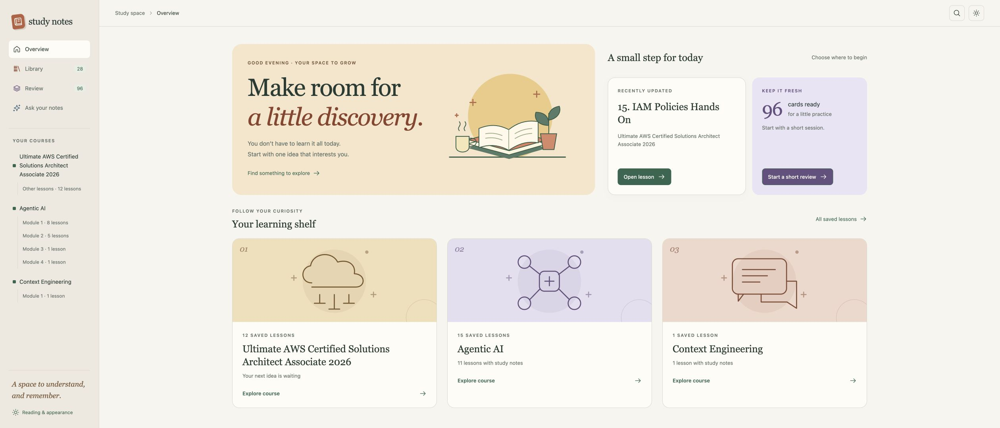

# Study Notes

Study Notes is a self-hosted study app for **Udemy** and **DeepLearning.AI** courses. Capture timestamped notes, quotes, screenshots, and Excalidraw sketches from a Chrome side panel. In the web workspace, revisit the exact moment in a lesson, search across transcripts and notes, review flashcards, and take quizzes backed by lesson excerpts.



## Run locally

You’ll need Chrome and Python 3.10+ with SQLite FTS5. Install Node.js and npm if you want to build the drawing editor or run the JavaScript tests.

```bash
git clone https://github.com/ajmalrasi/study-app.git
cd study-app
python3 -m venv .venv
source .venv/bin/activate
python -m pip install -r server/requirements.txt
python -m uvicorn server.app:app --port 8765 --reload
```

Open [the study workspace](http://localhost:8765). The server creates its data directory on first run. Capture, transcript reading, and search work without a model. To generate study notes, flashcards, quizzes, or answers in **Ask this course**, set `LLM_URL` to the full `/v1/chat/completions` URL of a reachable OpenAI-compatible endpoint and `LLM_MODEL` to its model ID before starting the server. The server sends requests without an API key. `/api/health` reports server status and checks the model host’s `/health` route.

To enable Excalidraw, run this from the repository root in a separate terminal. The build is served at `/draw/`.

```bash
npm --prefix draw ci
npm --prefix draw run build
```

### Load the Chrome extension

1. Open `chrome://extensions` and enable **Developer mode**.
2. Select **Load unpacked** and choose the repository’s `extension/` folder.
3. Open a lesson on `learn.deeplearning.ai` or an enrolled Udemy lecture. Click the **Study Notes** toolbar icon and open the side panel’s settings.
4. Set the server URL to `http://localhost:8765` for local development, or to the address of your deployed server, then click **Save**. Chrome may ask for access to a custom server’s origin.

After pulling updates, reload **Study Notes** on `chrome://extensions` and refresh the lesson tab.

## Capture and review a lesson

- **While watching**, type in the side panel to anchor the note at the time you start typing. In **Transcript**, click a caption to seek or select text to save it as a note. Chrome queues unsynced notes and retries when the server is reachable. Drawing requires a server connection.
- **Save captions** automatically from loaded lessons with **Save every lesson's transcript automatically** enabled by default. Caption availability depends on the course and your browser session. Use course transcript import when you want to fetch captions across multiple lessons.
- **Generate study material** with **Process lesson** in the extension. It uses the transcript and any notes to produce a summary, timestamped key concepts, and flashcards. In **Library**, **Generate all** queues eligible lessons in a course.
- **Review on the web** with notes, captures, and transcripts in context. Search for a passage, or open a course in the Library and expand **Ask this course** above its modules for answers grounded in its saved transcripts. Citations open the lesson and timestamp. **Review** schedules flashcards with spaced repetition and lets you undo a review.

| Default shortcut (Option on Mac) | Action |
| --- | --- |
| `Alt+N` | Open a quick note at the current timestamp |
| `Alt+S` | Save a screenshot |
| `Alt+D` | Capture a screenshot and open it in Excalidraw |
| `Alt+B` | Bookmark the current moment |

Use the side panel’s **Quote** button to save a recent caption. Shortcut bindings, including an optional one for **Quote**, are available at `chrome://extensions/shortcuts`.

## Create a quiz

1. For a whole course or specific Udemy sections or DeepLearning.AI modules, open a lesson in signed-in Chrome and select **Sync course sections** in the extension. You can also build a quiz from individual saved lessons.
2. In the web workspace, open **Quizzes** and choose your scope. Select **Fetch missing transcripts** if needed. Keep the signed-in course tab open while the extension imports available captions without playing the videos.
3. Choose 1–100 questions and a format, either multiple choice or written answer. Missing transcripts require explicit approval to create a partial quiz. The coverage view shows missing transcripts and which lessons the generated questions represent.
4. Start an attempt when generation finishes. Draft answers, feedback, and results are saved on the server. You can resume, retake, or practise missed questions while keeping earlier attempts.

Each quiz keeps a copy of its source excerpts so the original evidence stays available when a transcript changes.

## Data and deployment

The FastAPI server stores data in `server/data/` by default. Set `NOTES_DATA` to use a different directory. `notes.db` holds the SQLite database, `files/` contains screenshots and drawings, and `markdown/` contains per-lesson exports.

The bundled deployment runs the web workspace and API on a Raspberry Pi and uses a separate Jetson for model inference. The extension defaults to the Pi at `http://192.168.3.20:8765`. The server is intended for a trusted network and serves the workspace and API without authentication.

```bash
deploy/deploy.sh            # Build the editor and deploy to the default rpi SSH host
# deploy/deploy.sh my-pi    # Use a different SSH host
```

The deployment installs the user-level `study-notes` service and a nightly backup timer. The Pi stores app data under `~/apps/study_notes/data/` and snapshots it to `~/backups/study_notes/` at 03:30, retaining roughly two weeks of backups. Set `LLM_URL` and `LLM_MODEL` in `~/.config/study-notes.env` on the Pi. Check the service with `systemctl --user status study-notes` or follow its logs with `journalctl --user -u study-notes -f`.

Course Ask uses keyword search immediately after indexing and adds semantic search as each transcript’s vectors become ready. The deploy script installs the optional embedding runtime and checks the pinned BGE model on the Pi. For manual setup, install `server/requirements-embeddings.txt` and run `python server/course_embeddings.py <data-dir>/course-ask-model` before restarting. Omitting this setup leaves keyword-only retrieval available. Answer generation uses the configured Jetson endpoint. See the [course Ask design](docs/ASK_THIS_COURSE.md).

## Development checks

Run from the repository root with the Python environment activated. The API tests create temporary databases.

```bash
python -m pip install -r server/requirements-dev.txt
python -m unittest discover -s tests -v
for suite in tests/*.mjs; do node "$suite" || exit 1; done
```

- `extension/` contains the Chrome capture UI and course adapters.
- `server/` contains the API, quiz engine, and web workspace.
- `draw/` contains the Excalidraw editor.
- `deploy/` contains deployment, service, and backup scripts.

See the [review workspace design](docs/UI_DESIGN.md), [quiz engine notes](docs/SECTION_QUIZZES.md), and [DeepLearning.AI import details](docs/DEEPLEARNING_QUIZZES.md) for implementation context.
