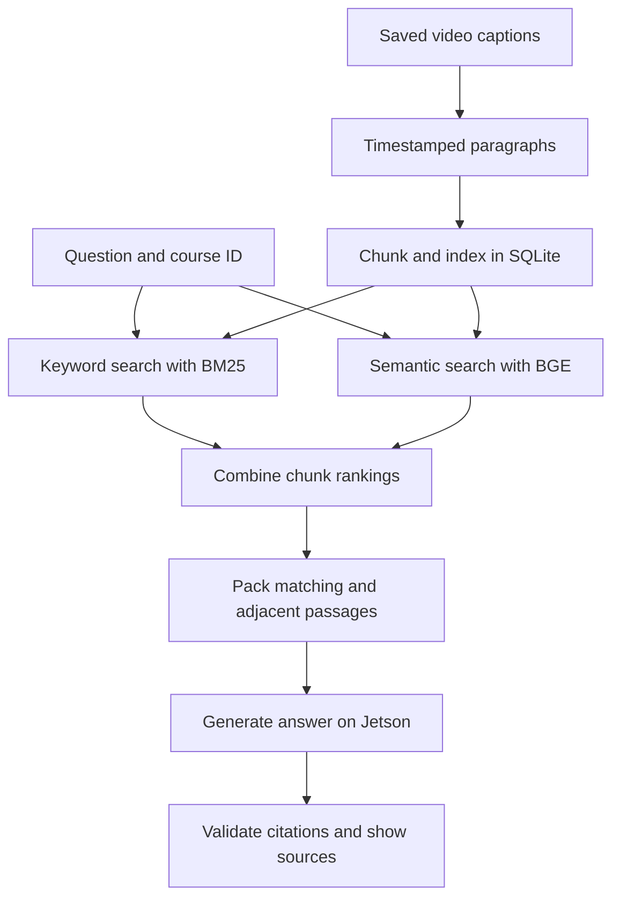

# Ask this course

Design and deployment acceptance criteria for transcript question answering in Study Notes.

## Study workflow

Open a course in the Library and expand **Ask this course** above its modules. The form shows how many transcripts are searchable and uses the open course for every question. The answer appears on the course page and cites saved transcript passages. Each citation shows the lesson title and opens the passage or jumps to its timestamp in the video.

An Agentic AI question about tool execution can draw on both *Planning with Code Execution* and *Multi-Agent Workflow*. A question asked from Context Engineering searches that course’s transcripts. When you open a different course, its question panel starts fresh.

## Architecture

The Raspberry Pi 5 hosts the API, transcript indexing, embeddings, vector storage, and retrieval. Use Stash Video Search as a reference for its pinned quantized `bge-small-en-v1.5` ONNX model, CLS pooling, vector normalization, and model-versioned storage. Stash stores its normalized 384-dimensional vectors in Qdrant alongside timestamped metadata. Study Notes stores its chunks and normalized vectors together in SQLite so index and transcript changes can share a transaction. Start with exact vector scoring across the selected course and measure retrieval latency on the Pi using the largest available course.

Use a Study Notes encoder on the Pi with its own tokenizer settings and the same pinned model and tokenizer artifacts as Stash. Add BGE’s retrieval instruction to questions. Embed transcript text as passages. Validate the vector count, dimensions, and finite values, and record the artifact revision and encoding settings in the index version. Verify the pinned ONNX export supports the planned input length before enabling semantic indexing.

For answer generation, reuse the configured OpenAI-compatible endpoint through the existing `LLM_URL` and `LLM_MODEL` settings, which target the Jetson in the bundled deployment. Send the question and selected passages in one generation call. Keyword retrieval can serve questions while the embedding index is pending or the encoder is unavailable. Use one bounded Pi backfill worker with short batches and give interactive question embeddings priority between batches.

## Transcript chunking

The current transcript code turns WebVTT into cues with start and end times, then groups those cues into roughly 30-second paragraphs. Preserve those paragraphs as the normal boundaries for links and group consecutive paragraphs into chunks for retrieval.

1. Process one transcript in cue order. Keep the caption text and cue times. Normalize whitespace and carry each paragraph’s existing anchor and first and last cue positions forward.
2. Start with a **320 BGE-token target** and a **450-token cap**, including special tokens. Aim to keep a complete explanation together, such as a setup, a code step, and what its output means. Close at a transcript paragraph boundary near the target that fits the cap. Count with the pinned BGE tokenizer with truncation disabled. Count generation tokens separately when packing the prompt.
3. Split an oversized paragraph at a caption boundary, preferring a sentence ending when one is available. For a single oversized cue, split its text into token-bounded pieces that share the cue’s original range. Give each piece a distinct ID and retain the parent paragraph anchor.
4. Merge a short final chunk into its predecessor if the combined chunk fits. Keep indexed chunks disjoint and preserve every usable cue, including the final one.

Store the chunk’s first start time and maximum cue end time in milliseconds. Keep the ordered source passages inside each chunk. The chunk is the unit of ranking. The smaller source passage is the unit of citation.

### Example

Suppose a hypothetical video introduces code generation at 2:10 and explains how execution output feeds planning at 3:05. A chunk covering the second step may rank highest for “What happens after the code runs?” Neighbor expansion can supply the earlier setup. The answer can cite the passage beginning at 3:05 for the handoff and earlier evidence when it describes the setup.

## SQLite and indexing

The stored caption cues are the source of truth. The Ask index is derived from them and can be rebuilt. Keep the existing notes and transcript search index available to its current callers.

| Record | Fields and purpose |
| --- | --- |
| Transcript index state | `lesson_id`, `transcript_hash`, `chunker_version`, `embedding_model_version`, and embedding progress. Identifies the current index revision. |
| Transcript chunk | `chunk_id`, `lesson_id`, `transcript_hash`, `chunk_index`, `start_ms`, `end_ms`, text, and ordered source passages. The source passages carry anchor IDs and timestamps. |
| Chunk FTS5 row | Chunk text keyed by `chunk_id` for BM25 ranking. |
| Chunk embedding | `chunk_id`, `embedding_model_version`, and normalized float32 vector. Scope candidates to the course before calculating similarity. |

Build and replace chunk and FTS rows for a changed transcript atomically with the saved caption revision. Identical caption imports keep the same hash and reuse the existing index. A bounded background worker backfills older lessons and computes embeddings in small batches outside the SQLite write transaction. Until a legacy video’s lexical rows are ready, show that its transcript is being indexed. The next request can use lexical retrieval once those rows are committed.

Before publishing a batch, the worker checks that the lesson and expected transcript, chunker, and model revisions still match. This prevents stale work from becoming visible after a transcript update or lesson deletion. Publish each lesson’s embedding revision atomically. On restart, resume pending lessons from stored state. A caption replacement swaps lexical data and invalidates its vectors, and a deletion removes the lesson’s derived rows. Backfill and retry should remain idempotent.

Resolve course membership from `lessons.course_id` during retrieval. Join every candidate through its owning lesson and use only chunks from that lesson’s current transcript revision. If a lesson is moved, its existing chunks become searchable in its new course without re-embedding.

## Hybrid retrieval and prompt construction

Each question runs two searches over the selected course’s chunks. Apply the course and current transcript revision filters **before** ranking and taking the top results. Keyword search covers every lesson with a ready chunk index, and semantic search covers the lessons with current vectors.

| Search | Role |
| --- | --- |
| **Keyword search** | SQLite FTS5 ranks up to **15 chunks** with BM25. This surfaces passages that mention the student’s terms, such as `ReAct`, an API name, or a function from a code walkthrough. Build the FTS expression from escaped terms. |
| **Semantic search** | Embed the question once and take up to **15 chunks** by cosine similarity. This connects paraphrases to the instructor’s wording, such as “make the model critique its first draft” to a passage on *reflection*. Count BGE’s query prefix and special tokens against the encoder’s input limit. |

1. **Merge the rankings.** Use reciprocal rank fusion over chunk IDs and start with up to **five** matches. Each list contributes from its rank positions, and a chunk found by both can benefit from both ranks. For questions that span lessons, prefer distinct supporting passages when candidates are near-tied. If the encoder is unavailable, pending, or the question exceeds its input limit, use the BM25 ranking. An empty candidate set yields insufficient evidence.
2. **Add context around matches.** Pack the matched chunks first. Add at most one immediate neighbor on each side of a match, within its own video and revision, as the budget allows. Deduplicate source IDs. Group selected passages by lesson and put each lesson’s passages in timestamp order. Include each lesson title, timestamps, and request-local source IDs such as `S1` and `S2`.
3. **Budget the generation prompt.** Include the instructions, question, passage labels, and timestamps in the count. Reserve **700 output tokens** and enforce the runtime’s input and total context limits. The [recorded Jetson configuration](DESIGN.md) allows **6,144 input tokens** and **8,192 total tokens**. The service accepts smaller prompts using a conservative UTF-8 byte bound plus template headroom. For larger prompts, it tries Jetson’s token-count endpoint. `COURSE_ASK_COUNT_URL`, `COURSE_ASK_INPUT_TOKENS`, and `COURSE_ASK_CONTEXT_TOKENS` let the deployment match its gateway. Drop whole neighbors first, then lower-ranked matches, when the count is unavailable or exceeds the budget. If a complete passage cannot fit, return a clear input-budget error.

The prompt treats the transcript and question as data. It asks for a concise answer supported by the supplied passages, with a source ID on each substantive claim. For partial coverage, answer the supported part and identify the gap. For unsupported questions, return an explicit insufficient-evidence result. An embedding similarity score alone carries no guarantee of relevance.

## API and citations

Add `POST /api/courses/{course_id}/ask` with a body containing `q`. Accept a trimmed, nonempty question with a 500-token upper bound. Require an existing course ID in the path and use it as the scope for both searches. Preserve the existing `/api/ask` contract for its current callers.

Return `status`, `answer`, `sources`, and transcript coverage for the selected course. Coverage counts saved transcripts and the number ready for keyword and vector search. Each source contains its request-local ID, lesson title, lesson and passage IDs, caption text, transcript revision, and timestamps. The server assigns these values from the passages it put in the prompt. For `answered` or `partial`, validate that the model cited supplied IDs and that each paragraph or item making claims about the course material has a citation. Treat malformed output or fabricated IDs as a failed answer and show the retrieved passages. The original excerpt stays visible so the student can judge whether it supports the answer.

| State | What the student sees |
| --- | --- |
| `answered` or `partial` | Answer with clickable citations and the cited excerpts. Partial answers flag what the retrieved course material leaves unanswered. |
| `insufficient_evidence` | A message that the indexed course transcript passages do not answer the question. |
| Course has no saved transcripts or keyword index pending for all transcripts | A prompt to save course transcripts or retry once indexing completes. |
| Generation endpoint busy, unavailable, or invalid answer | Relevant transcript passages and a retry action. The interactive request has a bounded deadline. |

Reuse the existing lesson transcript links and video timestamp links. When a paragraph was split for budgeting, link back to its original transcript anchor and use the piece’s actual cue time for video playback. Before returning the answer, check that the supplied passages are still current and their lessons still belong to the course. If a source changed or moved during generation, offer a retry against the current course. The Pi admits one Course Ask generation at a time and bounds the HTTP call to the Jetson.

## Implementation and acceptance

1. Implement chunk building, the SQLite lifecycle, and course-scoped BM25. Verify continuity, timestamp accuracy, cap enforcement, reload behavior, and explicit handling of missing transcripts with fixtures.
2. Connect prompt packing, generation through the existing endpoint, and the course UI. Exercise a question that needs evidence from two lessons and verify both timestamp citations. Put a stronger keyword and vector match in another course and assert it is excluded even when the selected course has sparse results. Verify course switching, partial indexing, lesson moves, and unavailable-model behavior.
3. Add local semantic retrieval and compare fused ranking against the lexical baseline. Use about 25 real study questions, including exact terms, paraphrases, explanations spanning chunks or lessons, and questions with no answer in the selected course. Include the Agentic AI videos *Multi-Agent Workflow* and *Planning with Code Execution* when their transcripts are available.

For the comparison, mark the supporting timestamps ahead of time and measure whether that evidence reaches the **final packed prompt**. Compare chunk sizes on multi-step explanations as well as narrow factual questions. Track citation support, correct abstentions, end-to-end latency, and Pi memory and CPU usage during embedding backfill. Check that caption capture and browsing remain responsive. Report the longest saved transcript by actual tokenizer count when the Pi’s caption data is accessible. Tune the starting chunk and retrieval sizes against these results before deployment.
